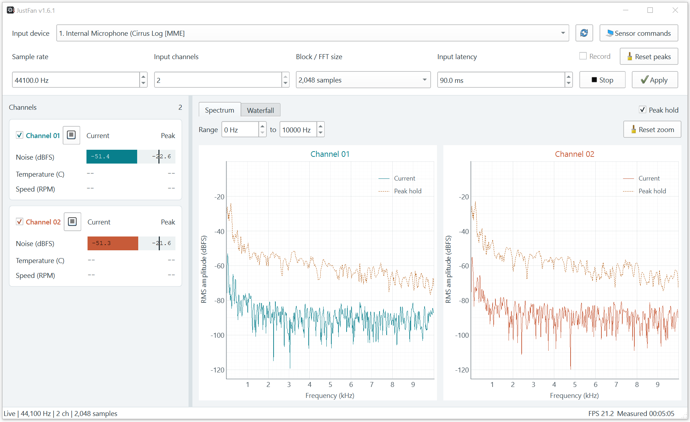

# JustFan


The NOISE is the top priority:
> A PC should keep quiet when it's idle.
>
> The NOISE is acceptable during work.
>
> Thus, you can think at your PC without NOISE when it should be quiet.

The JustFan aims to help monitor, control, and calibrate your PC’s cooling system.

[Usage guide](Usage.md)

## Features

### Implemented
- Noise monitoring across audio input channels
- Fundamental candidates with multi-selection and odd/even harmonic markers

### Not implemented yet
- Fan speed monitor
- Fan speed control with thermal feedback
- Automatic thermal calibration

## Screenshot



## Requirements

- Python 3.10 or newer
- Dependencies listed in `requirements.txt`
- A Windows or Linux desktop with microphone access

## Run

```shell
python3 JustFan.py
```

## Build a Windows executable

```shell
python3 -m PyInstaller --clean --noconfirm JustFan.spec
```

## Tests

```bash
python3 -m unittest -v
```

Tests use generated audio and a mocked input stream; they do not access a microphone.
