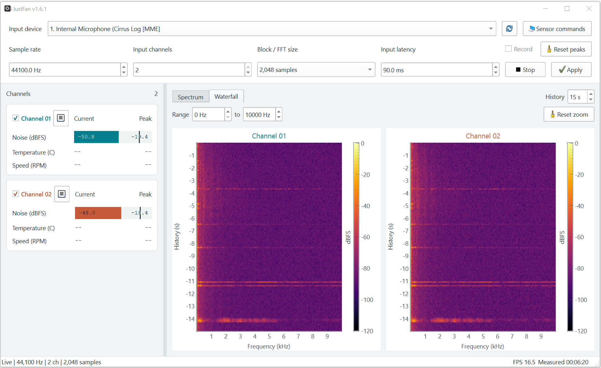
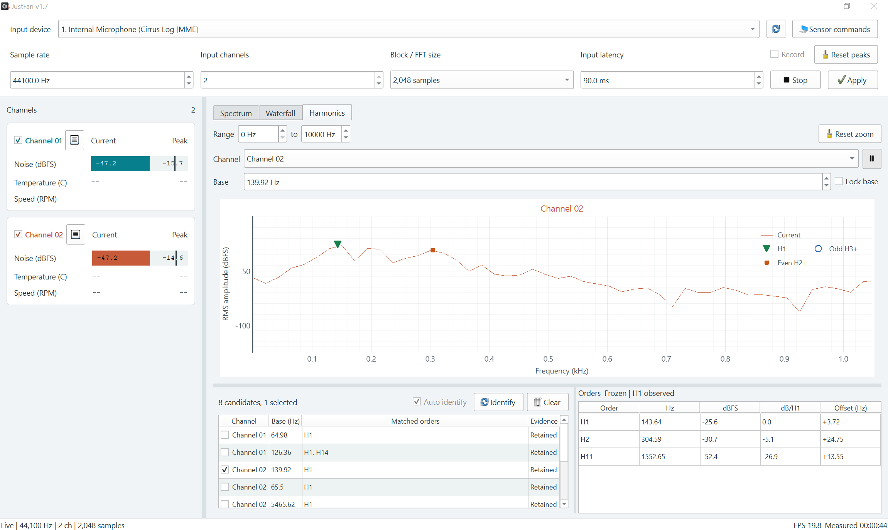

# Usage

## Measurement and Capture

Noise readings use **dBFS**, relative to digital full scale, not calibrated sound
pressure (dB SPL). Keep microphone position and input gain unchanged when
comparing measurements.

- **Current** is the RMS level of the latest audio block.
- **Peak** is the highest block RMS level in the measurement, not the highest
	individual sample.
- Channel checkboxes only hide plots in Spectrum and Waterfall. They do not
	disable audio capture, level readings, recording, or harmonic analysis.

| Setting | Effect |
| --- | --- |
| Sample rate | Sets the capture rate and limits analysis to half that frequency. |
| Input channels | Sets how many channels are captured from the selected device. |
| Block / FFT size | Sets both the capture block and Hann-window FFT length. Larger values separate nearby tones better but update more slowly. |
| Input latency | Requests a driver latency; the actual value may differ. |

FFT bin spacing is `sample rate / FFT size`: at 48,000 Hz, 4,096 samples gives
about 11.72 Hz, while 32,768 gives about 1.46 Hz. A larger FFT is useful for low
tones and closely spaced harmonics.

Capture settings take effect on **Start** or **Apply**. Both begin a new
measurement; Start does not resume a stopped measurement. Apply also starts
capture when stopped. Changing or refreshing the input device stops capture.

## Spectrum and Waterfall

**Spectrum** shows the current FFT. **Peak hold** adds the highest level seen at
each frequency since measurement start or the last peak reset. Hiding Peak hold
does not clear its history.

**Waterfall** shows frequency across the horizontal axis and time vertically,
with the newest audio at the top. Color represents level in dBFS. **History**
sets the visible time span from 5 to 120 seconds, defaulting to 15 seconds.

**Range** sets the frequency limits. Spectrum and Waterfall share these limits;
Harmonics has its own range and zoom. **Reset zoom** restores all channel plots
in the active view to its Range and default vertical scale without clearing data.
Double-click a channel plot to focus it; double-click again to restore the grid.

## Harmonics

### Candidates and Markers

**Identify** searches the current spectrum for possible base frequencies.
**Auto identify** checks fresh spectra about once a second while the Harmonics
page is visible and capture is running. It pauses when analysis is frozen or
the page is hidden. Manual Identify can still use stopped or frozen data.

Identification merges nearby matches into existing entries and appends new
ones, preserving checked candidates. The list is a history of detections, not
just the peaks present now.

| Evidence | Meaning |
| --- | --- |
| H1 observed | The base peak and higher harmonics were detected. |
| Inferred H1 | No base peak was detected; higher harmonics suggest a common base. |
| Single peak | A tone was detected, but no harmonic series is confirmed. |
| Retained | The entry was not matched in the latest identification; its previous detection is kept. |

Clicking a candidate row opens that channel and base in the analysis plot and
**Orders** table. Checking its Channel checkbox selects it for markers in
Spectrum; multiple bases can be checked, including on the same channel.

Markers indicate matched peaks: green triangles for H1, blue hollow circles for
odd orders H3 and above, and orange squares for even orders H2 and above.
**Show harmonic markers** toggles the Spectrum overlay without clearing checked
candidates or hiding the markers in Harmonics.

### Inspecting a Group

**Channel** and **Base** choose the signal and reference frequency to inspect.
Editing Base automatically enables **Lock base**, which prevents later candidate
updates from moving the reference. It does not freeze the measured spectrum.

The pause-icon button freezes the analysis spectrum and order readings. Manual
identification then uses that same frozen spectrum. Capture, level meters,
recording, and measured time continue; unfreezing catches up to the latest audio.

The Orders table lists observed peaks rather than every theoretical order:

- **dB/H1** is the level difference from the observed H1. It is `-` when H1 is
	absent; an inferred base does not supply a measured H1 level.
- **Offset (Hz)** is `measured frequency - order * Base`.
- Clicking an order places a frequency cursor in the plot. Clicking the plot
	selects the nearest matched order.

A harmonic pattern alone does not identify a particular fan or establish its RPM.

## Recording

Enable **Record** before starting capture; it cannot be changed while capture is
running and is off on each application launch. Recording saves all configured
input channels as **32-bit floating-point WAV**, regardless of hidden plots,
peak resets, or frozen harmonic analysis.

Files normally go to `Records/` under the working directory. If that location
is not writable, JustFan uses `JustFan/` under the system Music folder. Hover
over Record to see the destination, active file, or last saved file.

Filenames include the input device and local timestamp. On completion, a duration
suffix in `HHMMSS` is added, rounded down to whole seconds. Stop finalizes the
file; Apply finishes it and starts another if Record remains checked. Recording
errors are reported without stopping monitoring; an incomplete file may remain.

## What Gets Reset

| Action | Effect |
| --- | --- |
| Stop | Stops capture and finalizes recording; leaves readings, plots, and candidates available for inspection. |
| Reset peaks | Resets level peaks, spectrum peak hold, waterfall history, and measured time. Keeps current readings, candidates, and the ongoing recording. |
| Clear in Harmonics | Clears candidate history and selections, not level peaks, measured time, or recording. Auto identify waits for fresh audio before repopulating the list. |
| Start / Apply | Starts a new measurement, clearing peaks, waterfall history, candidates, the analysis freeze, and the manual base/lock. Starts a new recording if enabled. |

## Sensor Commands

Temperature and Speed (RPM) readings are not implemented. **Sensor commands**
only stores command text locally; it does not execute commands or control fans.
